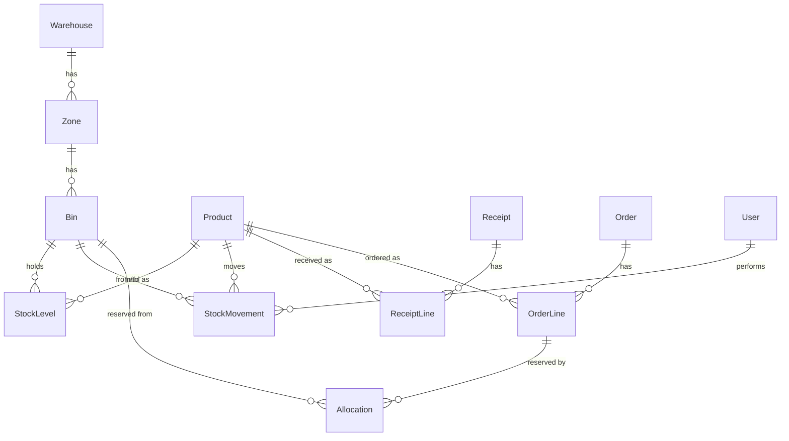

# Mini WMS: data model

Status: Accepted (Locations built and migrated; Products entity and schema only; the other tables are design only). Source: `docs/specs/product.md`. Storage rules: `docs/adr/ADR-002-ef-core-sqlite.md`.

## Conventions
- Table and column names are PascalCase; table names are plural (`Warehouses`, `Zones`, `Bins`, `Products`, and so on). The headings below use the singular entity name.
- Every table has `Id` (integer primary key, auto-increment).
- Every mutable table also has `CreatedAt`, `CreatedBy`, `UpdatedAt`, `UpdatedBy` (audit) and `Version` (`INTEGER` concurrency token). Append-only tables (`StockMovement`) have only `CreatedAt` and `CreatedBy`.
- Timestamps are UTC, stored as ticks in `INTEGER` columns (SQLite cannot order `DateTimeOffset`). Quantities are integers. Every text column with a maximum length has a `CHECK (length(...) <= max)` constraint, because SQLite does not enforce lengths. "Code" columns have a case-insensitive unique index (`COLLATE NOCASE`).
- Foreign keys are enforced (`PRAGMA foreign_keys = ON`) and are `ON DELETE RESTRICT`. Nothing is physically deleted; `IsActive` marks inactive records.

## Entity overview

## Tables

### Warehouse (module LOC)
| Column | Type | Rules |
|---|---|---|
| Code | text | required, max 20, unique; seeded `MAIN` |
| Name | text | required, max 100 |
| IsActive | bool | always true in version 1 |

Exactly one row exists (LOC-1.1). No endpoint creates or deletes warehouses.

### Zone (LOC)
| Column | Type | Rules |
|---|---|---|
| WarehouseId | FK Warehouse | required |
| Code | text | required, max 20, unique |
| Name | text | required, max 100 |
| Type | text | `Receiving`, `Storage` or `Shipping`; cannot change once the zone has any bin (LOC-2.1) |
| IsActive | bool | default true; cannot be false while the zone has an Active bin (LOC-2.4) |

### Bin (LOC)
| Column | Type | Rules |
|---|---|---|
| ZoneId | FK Zone | required |
| Code | text | required, max 30, unique across the warehouse (LOC-1.3) |
| Name | text | required, max 100 |
| IsActive | bool | default true; cannot be false while any `StockLevel.Quantity` is above 0 (LOC-2.2) |

### Product (module PRD)
| Column | Type | Rules |
|---|---|---|
| Sku | text | required, max 40, unique case-insensitive, immutable after creation (PRD-1.2, PRD-2.1) |
| Name | text | required, max 150 |
| UnitOfMeasure | text | required, max 20 (for example `EA`, `BOX`) |
| ReorderLevel | integer | 0 or more (PRD-1.3) |
| IsActive | bool | default true; cannot be false while total stock is above 0 (PRD-2.2) |

### StockLevel (module INV)
| Column | Type | Rules |
|---|---|---|
| ProductId | FK Product | required |
| BinId | FK Bin | required |
| Quantity | integer | 0 or more; the on-hand quantity |
| ReservedQuantity | integer | 0 to `Quantity`; total of open Allocations for this product and bin |

Unique on (`ProductId`, `BinId`). Available quantity is `Quantity - ReservedQuantity`. Changed only by the Inventory module (ADR-001).

### StockMovement (INV, append-only)
| Column | Type | Rules |
|---|---|---|
| Type | text | `Receive`, `PutAway`, `Transfer`, `Adjust`, `Pick`, `Ship` |
| ProductId | FK Product | required |
| FromBinId | FK Bin, nullable | null for Receive and upward Adjust |
| ToBinId | FK Bin, nullable | null for Ship and downward Adjust |
| Quantity | integer | above 0 (the amount moved; adjustments store the signed change in `QuantityChange`) |
| QuantityChange | integer, nullable | signed, for `Adjust` only |
| BeforeQuantity / AfterQuantity | integer | on the affected stock level (NFR-5) |
| Reason | text, nullable | required for `Adjust` (INV-2.3) |
| ReceiptId / OrderId | FK, nullable | links the movement to its document |
| CreatedAt / CreatedBy | | who and when |

Rows are never updated or deleted (INV-4.3).

### Receipt and ReceiptLine (module INB)
| Table | Column | Rules |
|---|---|---|
| Receipt | Number | generated, unique (for example `RC-000001`) |
| | Supplier | required, max 150 |
| | Status | `Draft`, `Received`, `PutAway`, `Cancelled` |
| ReceiptLine | ReceiptId, ProductId | required; Active product |
| | ExpectedQuantity | above 0 |
| | ReceivedQuantity | integer, null until received; difference shown (INB-2.2) |
| | ReceivingBinId | FK Bin in a Receiving zone, set on receive |
| | PutAwayQuantity | integer, default 0, up to `ReceivedQuantity` |

### Order, OrderLine and Allocation (module OUT)
| Table | Column | Rules |
|---|---|---|
| Order | Number | generated, unique (`OR-000001`) |
| | Customer | required, max 150 |
| | Status | `Draft`, `Allocated`, `Picked`, `Shipped`, `Cancelled` |
| OrderLine | OrderId, ProductId | required; Active product |
| | Quantity | above 0 |
| Allocation | OrderLineId, BinId | the bin chosen by the system (Storage zones only) |
| | Quantity | reserved from that bin |
| | PickedQuantity | 0 to `Quantity` |

### User (module AUT)
| Column | Type | Rules |
|---|---|---|
| UserName | text | required, unique case-insensitive |
| PasswordHash | text | salted hash; never returned (NFR-8) |
| Role | text | `Admin`, `Clerk`, `Viewer` |
| IsActive | bool | default true |
| FailedSignInCount / LockedUntil | integer / timestamp | support the lockout rule (AUT-1.3) |

## Key invariants (tested)
1. `0 <= ReservedQuantity <= Quantity` on every `StockLevel`.
2. Every stock change writes exactly one `StockMovement` per affected stock level, in the same transaction (NFR-4, NFR-5).
3. Stock exists only in Active bins; a bin or product with stock cannot be deactivated.
4. A product's total on hand is the sum of its `StockLevel.Quantity`; Low stock means total at or below `ReorderLevel` (INV-1.2).
5. Allocations draw only from Storage-zone bins, oldest stock first.

## Build order of the schema
Migrations are added per module as each module is built: LOC and PRD first (Warehouse, Zone, Bin, Product), then INV, INB, OUT, AUT. Tables for later modules are not created early.
