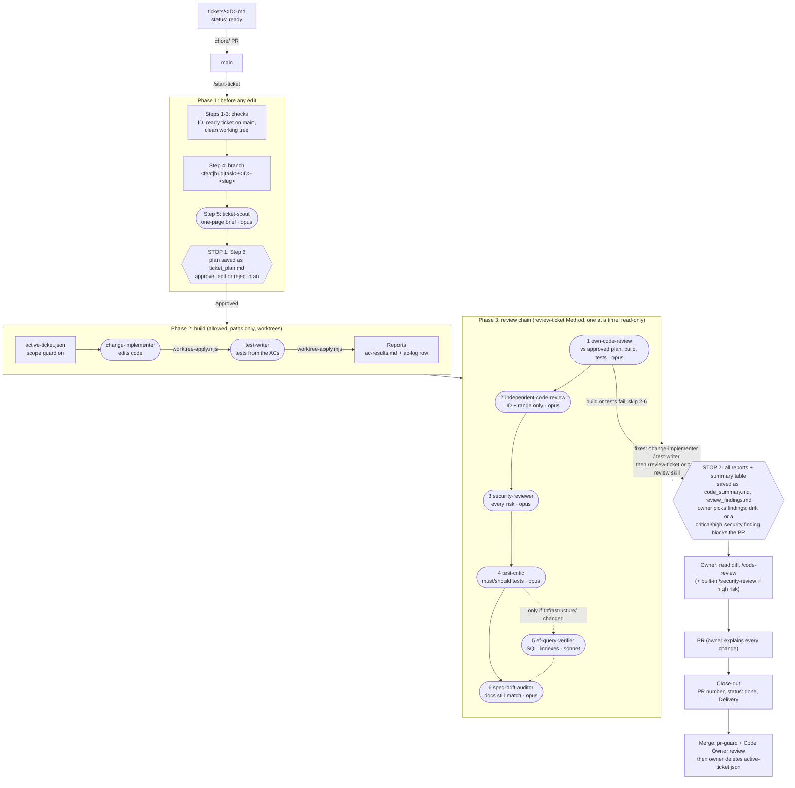

# Ticket workflow (local, replaces Jira and Confluence)

Rounded boxes are agents, hexagons are owner stops, dotted lines are conditional. The same diagram, with a table per step, is in [start-ticket-chain.pdf](start-ticket-chain.pdf).

1. **Create** the ticket from `tickets/_templates/`. Fill component, risk, `allowed_paths`, acceptance criteria. Set `status: ready` before it is committed, then merge it to `main` through a `chore/` PR. `/start-ticket` and `pr-guard` read the ticket from `main`, so a ticket that is not merged, or merged as `draft`, cannot start.
2. **Start**: `/start-ticket FEAT-001`. The skill creates branch `feat/FEAT-001-<slug>`, runs `ticket-scout`, prints the brief and a plan, saves the plan as `docs/reports/<ID>/ticket_plan.md`, then stops. A doc and code disagreement in the brief is named above the plan but does not stop the ticket; `spec-drift-auditor` checks the component in the review chain (step 5).
3. **Approve**: the owner approves, edits or rejects the plan. Nothing but `ticket_plan.md` is written before this; the skill then records the approved text and the status (approved or rejected, with the date) in it.
4. **Build**: `change-implementer` edits code, `test-writer` writes tests from the acceptance criteria. Scope and command guards run on every tool call.
5. **Review**:
   - `/start-ticket` runs the review chain after the build; `/review-ticket <ID>` runs the same chain on its own (for example after fixes). It runs, one after the other, the agents behind the review skills: `/own-code-review <ID>` (the change against the approved plan, plus build and tests), `/independent-code-review <ID>` (a fresh agent that never sees the plan), `/security-check <ID>` (the `security-reviewer` agent, on every ticket whatever its risk), `/test-critique <ID>` (weak tests, missing cases, a ranked list of tests to add), and `/ef-verify <ID>` when persistence changes, then `/spec-drift` on the component. Fail fast: if the build or tests fail in `own-code-review`, the chain stops there, skips the other five, and the fix goes back before a rerun. Drift found here stops the PR: fix the docs or the code, or record a decision to continue in the ticket Notes. A critical or high security finding stops it until fixed. The chain shows all reports and a summary, saves them as `docs/reports/<ID>/review_findings.md` and a change summary (changed files, agent reports, test results, AC totals) as `code_summary.md` (a rerun overwrites both), then stops once; the owner picks the findings to act on. Each review skill still runs alone.
   - Fixes go back to `change-implementer` (code) or `test-writer` (tests) under the active ticket.
   - Then the owner reads the diff, runs `/code-review` (plus the built-in `/security-review` as a second look on high risk) and opens the PR using the template. `ai-miss` label if a reviewer had to rewrite agent code.
6. **Close out**, before the PR merges: the PR number in `docs/reports/ac-log.md`, `status: done` and a `## Delivery` section in the ticket, pushed to the same PR. A ticket PR that merges first needs a second `chore/` PR for this.
7. **Merge**: `pr-guard` green plus Code Owner review. Only a person merges. Then the owner deletes `.claude/state/active-ticket.json` (the command guard blocks agents from deleting it).

Outside tickets, `/spec-drift` audits specs, contracts and context files against the code at any time.

Specs and decisions live in `docs/` (specs in `docs/specs/`, decisions in `docs/adr/`). Code facts live in the code; if a doc disagrees with the code, the code wins and the doc gets a fix.

## Learning loop
Each miss gets a cause and the narrowest fix: wrong or missing project knowledge -> `REPO_CONTEXT.md`; brief missed code -> knowledge-map entry;
unclear skill step -> `SKILL.md`; agent went too far -> agent `tools` / `model` / `maxTurns`; unsafe action not blocked -> hook or permission rule;
ticket lacked acceptance criteria -> ticket template. Log it in `docs/learning-log.md`, fix by PR.
